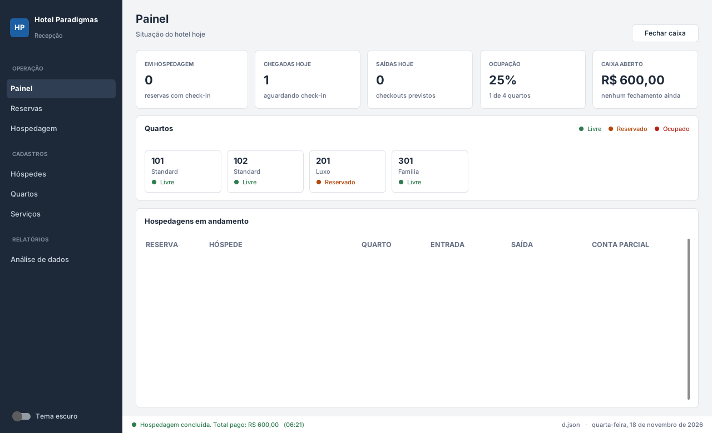
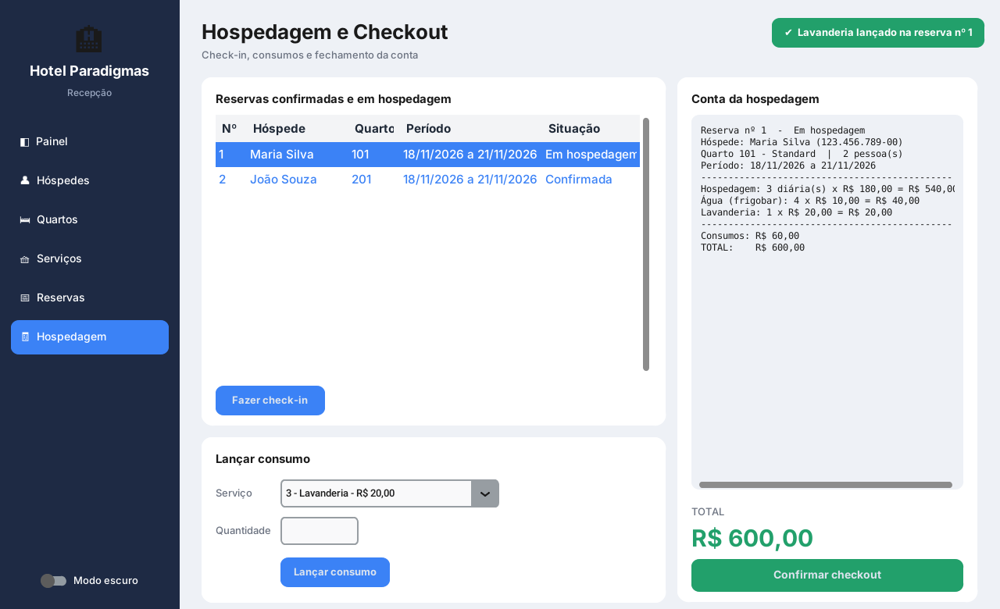

# 🏨 Sistema de Hotel em Python

Projeto do **Seminário de Paradigmas (19/11)**, no paradigma **Orientado a Objetos**.

Sistema de recepção de um pequeno hotel: cadastro de hóspedes, quartos e serviços,
reserva com verificação de disponibilidade, check-in, lançamento de consumos e checkout com a conta.



## ▶️ Como instalar e rodar (Windows)

1. Instale o **Python 3.10 ou mais novo** em <https://www.python.org/downloads/>.
   Na instalação, **marque "Add python.exe to PATH"**.
2. Baixe o projeto: botão verde **Code → Download ZIP** e extraia, ou use `git clone`.
3. Dê dois cliques em **`instalar.bat`**. Ele cria o ambiente, instala o CustomTkinter
   e roda os testes. No final deve aparecer `Todos os testes passaram!`.
4. Dê dois cliques em **`executar.bat`** para abrir o sistema.

Se der algum problema com o CustomTkinter, use **`executar_classico.bat`**:
é a mesma aplicação com o Tkinter puro, sem precisar instalar nada.

<details>
<summary>Pelo terminal (Windows, Linux ou macOS)</summary>

```bash
python -m venv .venv
.venv\Scripts\activate          # Windows
# source .venv/bin/activate     # Linux/macOS
pip install -r requirements.txt
python tests/teste_regras.py
python app.py
```

No Linux também dá para usar `./instalar.sh` e `./executar.sh`
(precisa do Tkinter: `sudo apt install python3-tk`).
</details>

Os dados ficam em `dados_hotel.json`, criado na primeira execução com 4 quartos e 4 serviços de exemplo.
**Apague esse arquivo antes de apresentar** para começar do zero.

## 📁 Organização

| Arquivo | O que tem |
|---|---|
| `modelos.py` | Classes do sistema: `Hospede`, `Quarto`, `Servico`, `Consumo`, `Reserva` e `Hotel`. Contém as regras, os cálculos e a gravação em JSON |
| `app.py` | Telas com visual moderno (CustomTkinter) |
| `analise.py` | Classe `Analise`: lê um arquivo JSON e calcula indicadores (faturamento, ocupação, ranking...) |
| `gerar_dados_exemplo.py` | Gera o `dados_exemplo.json` (um ano fictício de movimento, 557 reservas) |
| `dados_exemplo.json` | Dados fictícios usados pelos testes (opcional na Análise, via "Abrir JSON…") |
| `app_classico.py` | As telas básicas com Tkinter puro (versão reserva, sem a Análise de dados) |
| `estudo/` | **Material para aprender o código**: Python do projeto, mini-sistema, debug e mapa das telas |
| `GUIA_DE_ESTUDO.md` | **Para estudar**: o que cada classe faz, linhas do código, perguntas prováveis e divisão da fala |
| `tests/teste_regras.py` | Executa o roteiro da apresentação e confere os resultados |
| `tests/teste_analise.py` | Confere os cálculos da análise com números conhecidos |
| `instalar.bat` / `executar.bat` | Instalação e execução com dois cliques no Windows |
| `docs/prints/` | Capturas de tela |

## 🧩 Orientação a objetos no projeto

```
Hospede ──1──┐                 ┌──1── Quarto
             └──── Reserva ────┘
                      │ 0..*
                   Consumo ──1── Servico
```

- **Associação**: `Reserva` referencia um `Hospede` e um `Quarto`.
- **Composição**: `Reserva` contém a lista dos seus `Consumo`.
- **Cálculos nas classes**: `Consumo.subtotal`, `Reserva.qtd_diarias`, `Reserva.valor_hospedagem`, `Reserva.total`, `FechamentoCaixa.total`.
- **Fechamento de caixa**: `FechamentoCaixa` reúne as hospedagens concluídas desde o fechamento anterior.
- **Encapsulamento**: `Quarto.diaria` é uma `@property` que valida o valor.
- **Herança**: cada tela herda de `Pagina`; `Indicador` herda de `Cartao`. `Cartao`, `Formulario`, `Tabela` e `Grafico` são componentes reutilizáveis.
- **Separação**: as telas só chamam os métodos das classes. Toda regra fica em `modelos.py`.

### Regras de negócio
- Conflito de datas: há conflito quando `nova_entrada < saida_existente` e `nova_saida > entrada_existente`.
  A data de saída libera o quarto, então quem sai dia 22 permite que outro hóspede entre dia 22.
- A quantidade de pessoas precisa caber no quarto. A saída deve ser posterior à entrada.
- Situações da reserva: Confirmada → Em hospedagem → Concluída. Só a Confirmada pode ser cancelada.
- Consumos só podem ser lançados durante a hospedagem.
- A diária e o preço dos consumos ficam guardados na reserva: se o catálogo mudar, a conta não muda.
- Dinheiro usa `Decimal`, nunca `float`.

### Validações dos cadastros (`modelos.py`, valem para as duas telas)
| Campo | Regra |
|---|---|
| Nome | 3 a 60 caracteres, só letras (aceita espaço, apóstrofo, hífen e ponto) |
| Documento | CPF com 11 dígitos ou RG com 7 a 9 (pode terminar em X). Aceita pontos e traço, guarda só os números. Não repete |
| Telefone | Opcional. Se informado: DDD + número (10 ou 11 dígitos) |
| Quarto | Número até 6 caracteres, categoria até 20, capacidade de 1 a 10 |
| Serviço | Descrição de 2 a 40 caracteres, preço não negativo |

Nas telas, os campos também **impedem digitar além do limite** e **formatam enquanto a pessoa digita**
(`mascara_documento` → `123.456.789-00` e `mascara_telefone` → `(11) 99999-0000`), usando a função `limitar_entrada`.

### Exclusão de cadastros
Cada tela (Hóspedes, Quartos, Serviços) tem o botão **Excluir selecionado**, que chama `Hotel.excluir_hospede`, `excluir_quarto` e `excluir_servico`.
- Não exclui hóspede ou quarto com reserva **ativa ou concluída**, para a conta não ficar sem dono (integridade dos dados).
- Reservas **canceladas** são apagadas junto, porque não têm valor financeiro.
- Não exclui serviço que já foi lançado em alguma hospedagem.

### Fechamento de caixa
O botão **Fechar caixa** (no Painel) chama `Hotel.fechar_caixa()`:
- reúne as hospedagens concluídas que ainda não entraram em nenhum fechamento;
- o indicador **Caixa aberto** do painel volta a R$ 0,00;
- grava o relatório em `fechamentos/caixa_001.txt`, no formato de cupom;
- **nada é apagado**: o histórico completo continua na Análise de dados.

Não dá para fechar um caixa vazio. Os fechamentos ficam salvos no `dados_hotel.json`.

## 📊 Análise de dados (leitura de JSON)

A tela **Análise de dados** usa a classe `Analise` (`analise.py`) para **ler um arquivo JSON** e calcular:
faturamento total, por mês e por quarto; ticket médio; taxa de ocupação; taxa de cancelamento;
serviços mais consumidos e ranking de hóspedes. Os gráficos são desenhados no `Canvas` do Tkinter.

- Ao abrir a tela, ela analisa **os dados do hotel** (o que está cadastrado no sistema).
- **Abrir JSON…**: analisa outro arquivo no mesmo formato. Arquivo inválido gera um aviso, não um erro.
  O botão **Voltar aos dados do hotel** aparece enquanto outro arquivo estiver aberto.
- **Exportar CSV**: grava as hospedagens concluídas em um arquivo que abre no Excel.

A análise só **lê**: nunca altera nem grava o arquivo. Os valores vêm dos cálculos que já existem
nas classes (`Reserva.total`, `Consumo.subtotal`...), usando `Decimal`.

O `dados_exemplo.json` (557 reservas fictícias de 2026) **não aparece no sistema**: ele é usado
pelos testes e pode ser aberto pelo botão **Abrir JSON…** se quiserem mostrar gráficos com mais dados.
Para gerá-lo de novo: `python gerar_dados_exemplo.py`.

## 🎤 Roteiro da demonstração

1. **Painel**: mostrar o mapa de quartos (verde = livre, amarelo = reservado, vermelho = ocupado).
2. **Hóspedes**: cadastrar "Maria Silva".
3. **Reservas**: Maria, 19/11/2026 a 22/11/2026, 2 pessoas → consultar → quarto 101 → confirmar.
4. Consultar 20/11/2026 a 23/11/2026: o 101 não aparece mais porque há conflito.
5. **Hospedagem**: selecionar a reserva → check-in.
6. Lançar 4 × Água (frigobar) e 1 × Lavanderia.
7. Conferir a conta: 3 × R$ 180,00 + R$ 40,00 + R$ 20,00 = **R$ 600,00** → confirmar checkout.
8. **Painel**: o caixa aberto mostra R$ 600,00. Clicar em **Fechar caixa**: aparece o relatório e o caixa volta a R$ 0,00.
9. **Análise de dados**: mostrar os indicadores da hospedagem que acabou de ser feita. Exportar o CSV e abrir no Excel.
10. Extra: em **Quartos**, mudar a diária do 101. As reservas já feitas mantêm R$ 180,00.


